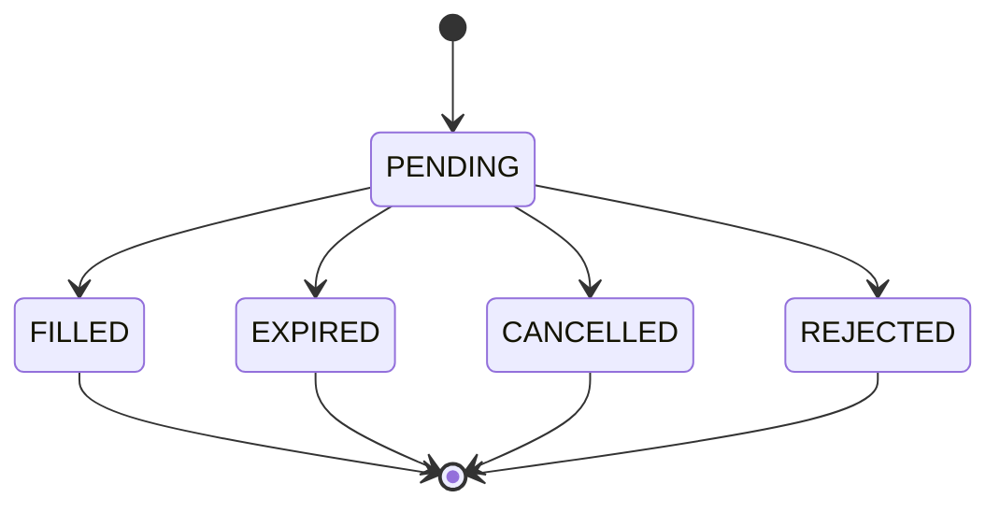

# Paper Order Lifecycle — Design and Acceptance Criteria

**Status:** Design approved for implementation planning; not implemented end-to-end yet.  
**Scope:** Paper/shadow execution only. This document does not authorize exchange orders or live trading.

## 1. Why this phase exists

The current position engine stores only `OPEN` and `CLOSED` positions. It does not have a durable order record for a strategy signal before a simulated fill. That makes it difficult to distinguish a signal waiting for its intended next-bar open from an order that filled, expired because the engine was late, was cancelled, or was rejected by a risk gate.

PR #239 also corrected a timing defect: a signal is evaluated on a fully closed candle, and a simulated entry is only permitted on the immediately following, currently forming candle. Missing, stale, future-dated, or gapped candle data must not cause an entry to be backfilled at a historical open.

## 2. State model

`paper_orders.status` should use these states:

- `PENDING`: signal accepted for evaluation at its intended next-candle open; no position has been opened yet.
- `FILLED`: simulated fill completed and linked to a `paper_positions` row.
- `EXPIRED`: intended entry candle was missed, stale, or unavailable before a valid fill.
- `CANCELLED`: an authorized user cancelled an order while it was pending.
- `REJECTED`: a risk, ML, or validation gate rejected the order before a fill.

Allowed transitions:

Terminal states are immutable. Retrying a poll must never resurrect a terminal order or fill the same order twice.

## 3. Timing and signal rules

1. Build signal conditions from fully closed candles only.
2. Identify the signal candle by `signal_open_time`; identify the intended entry candle by `entry_time`.
3. Persist a `PENDING` order with a stable idempotency key derived from strategy configuration and signal time.
4. Fill only when the current raw candle has `is_closed=0`, its open time exactly equals the order's intended entry time, and the current time is inside that candle's interval.
5. If the intended candle is already closed, a later candle is active, or the data is missing/gapped/stale, transition to `EXPIRED`. Never backfill at a past candle open.
6. Evaluate ML and risk gates fail-closed before the fill. An active or unverifiable emergency stop, unknown exposure, or failed required ML filter must never produce a fill.
7. Do not use the forming candle's incomplete indicators to make a signal. Its raw open is execution data only; signal features remain from the prior closed candle.

## 4. Persistence and concurrency invariants

The implementation should add a versioned migration (next migration after `015_system_flags`) creating `paper_orders` with, at minimum:

- order ID and strategy identity: symbol, market, timeframe, strategy name;
- signal candle time and intended entry candle time;
- direction, requested entry, stop, target, and ATR-at-signal;
- optional ML model ID/probability;
- state, state reason, created/updated timestamps;
- fill timestamp/price and linked paper position ID;
- a unique idempotency key for the same strategy configuration and signal candle;
- indexes for pending-order lookup and recent order history.

Use compare-and-set transitions (`UPDATE ... WHERE id=? AND status='PENDING'`) so concurrent pollers cannot fill or cancel the same order twice. Prefer a single transaction for the order transition and position insert. If the existing position-insert helper must be refactored to accept a caller-owned connection, preserve its shared accounting, exposure cap, and unique-open-position constraints. Do not implement a non-atomic two-write path without crash-recovery reconciliation.

## 5. API and dashboard behavior

- A signed-in trader/admin can list recent orders, optionally filtered by state.
- A trader/admin can cancel only a `PENDING` order. Attempts to cancel a terminal order return a conflict and leave it unchanged.
- Order responses expose state and reason but never database credentials, tokens, or secrets.
- The dashboard should eventually show order state separately from open positions and closed trades. Do not present a pending order as an open position or a fill as confirmed before persistence succeeds.
- Every path remains paper-only. No exchange order endpoint or exchange credentials are added.

## 6. Required regression and integration tests

- A closed-candle signal creates one pending order with the correct signal/entry timestamps.
- Duplicate polls and concurrent workers cannot create duplicate orders or positions.
- A valid current next candle fills once and links exactly one position.
- A missed, stale, future-dated, or gapped entry candle expires rather than backfilling.
- Cancel succeeds only from `PENDING`; repeated cancel/fill attempts cannot mutate terminal states.
- Circuit-breaker, exposure, and required ML failures reject/block fills.
- A crash between order creation and fill is recoverable; a crash after position creation cannot leave an indefinitely pending order.
- Migration succeeds on a fresh database and upgrades an existing database without rewriting historical positions/trades.
- Route authorization tests verify anonymous users cannot list/cancel and viewers cannot mutate.

## 7. Implementation phases

1. **Timing guard (merged PR #239):** only use the immediate next open candle; skip stale/missing data.
2. **Durable ledger and transition service:** migration, idempotent creation, guarded state changes, concurrency/recovery tests.
3. **Engine integration and API:** persist pending orders, fill/expire/reject deterministically, add list/cancel endpoints, and reconcile crash windows.
4. **Dashboard and release verification:** show pending/filled/expired/cancelled/rejected states, run browser/accessibility checks, run the MariaDB integration suite, and verify docs against the deployed version if deployment is explicitly requested.

The execution-lifecycle phase is complete only after phases 2–4 are implemented and verified. PR #239 alone fixes timing but does not satisfy that completion gate.
