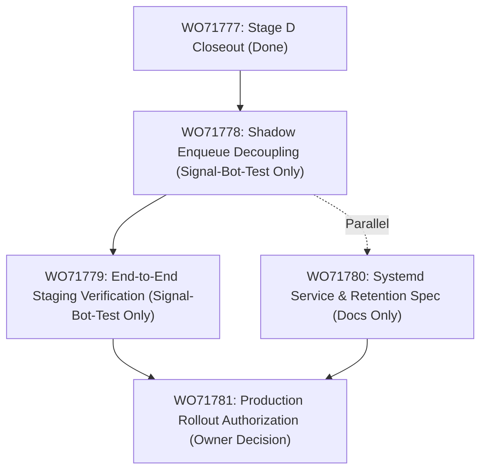

# Work Order 71777 — RetailBot2 Outbox Stage D Readiness Closeout and Acceleration Report

**Repository:** `kurnFR/signal-bot`  
**Subsystem:** RetailBot2 Telegram Outbox  
**Related Work Orders:** WO71763–WO71776  
**Current Master Baseline:** `a2c850aa8f97f081e22008d1efc0d3654c379dbe`  
**Dedicated Worktree:** `/home/BIS/signal-bot-wo71767-prod-validation`  
**Production Database:** `crypto_signals`  
**Test Database:** `signal_bot_test`  
**Mode:** Audit, Source Review, Documentation and Test-Environment Planning  
**Status & Final Verdict:** **`PASS_READY_FOR_IMPLEMENTATION`**  

---

## 1. Baseline & Lineage Verification

A strict baseline audit was conducted against git history and repository sources:
- **Master HEAD SHA:** `a2c850aa8f97f081e22008d1efc0d3654c379dbe` (origin/master).
- **PR #752 Status:** Merged into master at SHA `a2c850aa8f97f081e22008d1efc0d3654c379dbe`.
- **Intervening Commits:** Confirmed 0 intervening commits between PR #752 merge and current origin/master.
- **Source Verification:** `git diff HEAD paper/outbox_worker.py paper/retailbot2.py` produced 0 diffs.
- **Preservation Check:** All existing worktrees and all 21 modified screenshot PNGs in `docs/screenshots/` remain completely intact.

---

## 2. Reconciled Rollout Gate Matrix

The 15 rollout gates defined across WO71763–WO71776 are reconciled below with existing verified evidence:

| # | Gate Name | Required Implementation | Existing Evidence | Work Order Ref | Remaining Gap | Completion Criterion | Owner Auth Req? | Status |
|:---:|:---|:---|:---|:---:|:---|:---|:---:|:---:|
| **1** | Production Schema Compatibility | 13-column `rdt_telegram_outbox` table verified against `information_schema`. | Preflight passed in WO71767, WO71773, WO71774, WO71776. | WO71767, WO71774, WO71776 | None | Verified 13-column schema. | No | **COMPLETED** |
| **2** | Dedicated Observation Credential Isolation | Account `retailbot2_obs@127.0.0.1`, SELECT-only on `rdt_telegram_outbox`, USAGE global; secret in `~/.retailbot2_obs.secret` (0600); fail-closed resolver without fallback. | Provisioned (WO71773), rotated (WO71774), verified in observation trial (WO71776). | WO71773, WO71774, WO71776 | None | Dedicated credentials authenticating over loopback. | No | **COMPLETED** |
| **3** | Read-Only Observation Mode | `--observation` CLI flag and `OutboxWorker(observation_mode=True)` that loops `inspect_queue()` under advisory lock without claiming, mutating, or transmitting. | 66.51s live trial against `crypto_signals` (WO71776) with 66 read-only summaries and 0 mutations. | WO71764, WO71765, WO71776 | None | Zero claims, zero DML/DDL, 100% read-only. | No | **COMPLETED** |
| **4** | Advisory Lock Ownership & Shutdown | Exclusive MariaDB advisory lock `rdt_outbox_worker_lock` via `GET_LOCK(..., 0)`, checked via `IS_USED_LOCK()`, heartbeat in loop, clean release on graceful shutdown (SIGINT/SIGTERM). | Production trial WO71776 (conn 218746, held 66s, released to NULL on SIGINT); 18 passed in `test_outbox_worker_ownership_mariadb.py`. | WO71776, `tests/test_outbox_worker_ownership_mariadb.py` | None | Lock acquired, held, and cleanly released to NULL. | No | **COMPLETED** |
| **5** | Enqueue Authorization Gate | `SELECT DATABASE()` active connection identity check, exact match with configured DB, allowlist `("signal_bot_test", "crypto_signals")`; dual flags for prod (`RETAILBOT2_OUTBOX_ENQUEUE_ENABLED=1` AND `RETAILBOT2_PRODUCTION_ENQUEUE_ENABLED=1`). | 46/46 passed in `tests/test_retailbot2_outbox_enqueue_auth.py`; fails closed on unset/malformed flags. | WO71760, WO71764, PR #751, PR #752 | Production enqueue flag remains disabled by policy. | Fail-closed authorization gate. | Yes (for prod activation) | **COMPLETED (LOGIC)** |
| **6** | Trade-Persistence & Enqueue Atomicity | Atomic persistence: `save_trade()` and `close_trade_and_update_stats()` insert/update trade and outbox event on the same DB connection within a single transaction. | 39/39 passed in `tests/test_retailbot2_telegram_outbox.py`; code audit confirmed atomic commit/rollback. | PR #752, `tests/test_retailbot2_telegram_outbox.py` | **Coupling blocker**: cannot enqueue entry event without saving trade with `RETAILBOT2_ALLOW_TRADING=1`. | Decouple paper signal enqueue from live exchange trading. | No (for test DB) | **OPEN (BLOCKER 1)** |
| **7** | Telegram Delivery Authorization | Dual-key gate: `RETAILBOT2_ALLOW_TELEGRAM_DELIVERY=1` AND valid bot credentials. Fails closed before transport. | 30/30 passed in `tests/test_retailbot2_production_startup_safety.py`. | PR #744, PR #752 | Production Telegram credentials unconfigured; flag disabled. | End-to-end mock delivery in staging, then prod activation. | Yes | **OPEN (AWAITING PROD)** |
| **8** | Claim-Token Fencing | 32-char UUID `claim_token` assigned during `claim_event()`; all status transitions (`mark_sent`, `mark_retry`, `mark_dead`) require `WHERE id=%s AND claim_token=%s AND status='processing'`. | Passed in `tests/test_retailbot2_outbox_delivery_mysql.py` (test 6) and `test_retailbot2_telegram_outbox.py`. | PR #748, PR #749, `tests/test_retailbot2_outbox_delivery_mysql.py` | None | Stale worker acknowledgments rejected. | No | **COMPLETED** |
| **9** | Retry & Exponential Backoff | Exponential backoff delay scheduling with capped max attempts (8 attempts). | Passed in `test_retailbot2_telegram_outbox.py` and `test_retailbot2_outbox_delivery_mysql.py`. | PR #747, `tests/test_retailbot2_telegram_outbox.py` | None | Configurable backoff and attempt threshold. | No | **COMPLETED** |
| **10** | Dead-Letter Behavior & Alerting | Unrecoverable payload errors, permanent Telegram HTTP errors (4xx), or attempts >= 8 move event to status `'dead'` with `last_error` recorded. | Passed in `tests/test_retailbot2_outbox_delivery_mysql.py` and `test_retailbot2_telegram_outbox.py`. | PR #747, `tests/test_retailbot2_outbox_delivery_mysql.py` | Operational alerting/dashboard for dead-letter count > 0. | Read-only metric/alert query. | No | **COMPLETED (LOGIC) / GAP (ALERTING)** |
| **11** | Uncertain HTTP Outcome Handling | Outcomes classified into `CONFIRMED_DELIVERED`, `CONFIRMED_NOT_DELIVERED`, and `DELIVERY_UNKNOWN`. `DELIVERY_UNKNOWN` never marked sent; retried with backoff; manual replay requires explicit duplicate-risk acceptance. | 24/24 passed in `tests/test_outbox_transport.py`; documented in `docs/RETAILBOT2_AND_MODERN_UI_RELEASE_GATES.md` Section 4.5. | WO71766, PR #752 | Manual replay tooling. | Runbook procedure verified. | No | **COMPLETED** |
| **12** | Worker Process Supervision | Subprocess transport dispatch in isolated process group (`os.setpgid`), process inspection via `/proc`, graceful escalation (`SIGTERM` -> grace period -> `SIGKILL`), and `FATAL_LOCKOUT` state if child cleanup fails. | 18/18 passed in `tests/test_outbox_process_lifecycle.py`; 10/10 in `test_run_all_outbox_supervision.py`. | PR #746, `tests/test_outbox_process_lifecycle.py` | Systemd service unit definition for production daemonization. | Production systemd unit file. | Yes (for deployment) | **COMPLETED (SAFETY) / GAP (DAEMON)** |
| **13** | Queue Retention & Cleanup | Purge policy for delivered (`status='sent'`) events older than retention window (e.g. 30 days) to prevent table bloat. | Schema contains `sent_at` and `created_at` with indexing. | Schema 026 | Scheduled maintenance purge script. | Automated retention query. | No | **OPEN (LOW)** |
| **14** | Operational Monitoring & Recovery | Read-only monitoring queries for due depth, dead-letter count, stale processing count; manual recovery procedure. | Documented in `docs/RETAILBOT2_AND_MODERN_UI_RELEASE_GATES.md` Section 4.5; verified in WO71776. | WO71767, WO71776 | Automated health check endpoint. | CLI / endpoint health check. | No | **COMPLETED (PROCEDURAL)** |
| **15** | Migration 028 Relationship | Review whether `028_retailbot2_safe_control_defaults` is required for Telegram notifications. | Code audit confirms migration 028 alters only `bot_control.enabled` and does not affect `rdt_telegram_outbox`. Outbox schema passes 100% without it. | `db/migrate.py`, `tests/test_retailbot2_migration_managed_startup.py` | Formal decision record. | Formal decision documented: **NOT REQUIRED**. | No | **COMPLETED (DECISION)** |

---

## 3. Critical Architecture Review: Shadow Enqueue Coupling

### The Problem
In the existing codebase (`paper/retailbot2.py`), outbox event enqueuing for trade lifecycle events is embedded directly within:
1. `DatabaseManager.save_trade()` (lines 1590–1608) for entry alerts.
2. `DatabaseManager.close_trade_and_update_stats()` (lines 1695–1715) for exit alerts.

Both entry trade generation and persistence enforce:
```python
if not getattr(self, "trading_enabled", False) or not is_trading_authorized(getattr(self, "config", None)):
    return None
```
And inside `save_trade()`:
```python
if not is_trading_authorized(getattr(self, "config", None)):
    return None
```
Because `is_trading_authorized()` requires `RETAILBOT2_ALLOW_TRADING=1`, it is currently impossible to generate entry outbox events without:
- Enabling live trade execution authorization.
- Creating an active trade row in `rdt_trades`.

### Transaction Atomicity
- Trade persistence and outbox enqueue **are committed atomically** within the same database transaction on connection `conn`.
- If outbox enqueue fails, `conn.rollback()` rolls back the trade insertion/update.
- If outbox enqueue is unauthorized, the enqueue statement is bypassed and only the trade is committed.
- Decoupling must **not** break this atomic guarantee for real trades, nor should it introduce duplicate or phantom notifications.

### Recommended Smallest Safe Architectural Change
Introduce a dedicated **Shadow Enqueue & Paper Notification Mode**:
1. Keep `save_trade()` and `close_trade_and_update_stats()` atomic for real/paper trades.
2. Add a standalone event payload builder and enqueuer in `DatabaseManager`:
   `enqueue_trade_signal_event(signal, units, mode, event_type="entry")`
   which can enqueue an alert event directly into `rdt_telegram_outbox` for simulated/paper signals without requiring `RETAILBOT2_ALLOW_TRADING=1`.
3. Provide an explicit CLI and configuration flag: `RETAILBOT2_SHADOW_ENQUEUE_ENABLED=1`.
4. This allows testing the entire outbox pipeline (payload formatting, enqueue authorization, outbox storage, worker claiming, delivery dispatch) end-to-end without touching real exchange trading.

---

## 4. Test-Environment Completion Plan (`signal_bot_test`)

All validation is pinned strictly to `signal_bot_test` with mock transport (zero Telegram network calls):

```bash
SIGNAL_BOT_RUN_RETAILBOT2_DB_INTEGRATION=1 \
SIGNAL_BOT_TEST_DB_USER=<user> \
SIGNAL_BOT_TEST_DB_PASSWORD=<pass> \
pytest -v \
  tests/test_retailbot2_outbox_delivery_mysql.py \
  tests/test_retailbot2_telegram_outbox.py \
  tests/test_retailbot2_outbox_enqueue_auth.py \
  tests/test_outbox_worker_ownership_mariadb.py \
  tests/test_outbox_worker_observation.py \
  tests/test_outbox_process_lifecycle.py \
  tests/test_outbox_transport.py \
  tests/test_retailbot2_production_startup_safety.py \
  tests/test_run_all_outbox_supervision.py \
  tests/test_retailbot2_migration_managed_startup.py
```

### Coverage Mapping:
- **Entry & Exit Event Creation:** Covered by `test_entry_trade_and_outbox_event_commit_in_one_transaction`, `test_closed_trade_persists_exit_event_and_dispatches_confirmed_delivery`, and `test_exit_close_stats_and_outbox_event_commit_atomically`.
- **Idempotent Event Keys:** Pinned to `UNIQUE KEY uk_rdt_telegram_outbox_event (event_key)` with `ON DUPLICATE KEY UPDATE`.
- **Atomic Persistence:** Verified by `test_entry_outbox_failure_rolls_back_trade_insert` and `test_exit_outbox_failure_rolls_back_trade_close_and_stats`.
- **Worker Ownership & Contention:** Verified by `test_active_lease_prevents_second_worker_from_claiming_same_event` and `test_outbox_worker_ownership_mariadb.py`.
- **Claim-Token Fencing:** Verified by `test_stale_claim_acknowledgement_is_rejected` and `test_mark_sent_rejects_stale_claim_without_commit`.
- **Expired Lease Recovery:** Verified by `test_dispatcher_recovers_expired_claim_after_worker_interruption`.
- **Retry Scheduling & Backoff:** Verified by `test_dispatcher_retries_failed_send_then_marks_confirmed_send_sent` and `test_retry_outbox_event_backoff_boundaries_and_dead_letter_threshold`.
- **Dead-Letter Transition:** Verified by `test_expired_final_attempt_is_dead_lettered_not_reclaimed` and `test_dead_letter_outbox_event_uses_fenced_terminal_transition`.
- **Mock Transport Outcomes:** 24 tests in `test_outbox_transport.py` covering HTTP 200 ok=true, HTTP 200 ok=false, permanent 4xx, rate-limiting 429, retry-after parsing, and malformed JSON.
- **Uncertain Delivery Handling:** Covered by `test_http_200_malformed_json` and transport timeout escalation tests.
- **Graceful Shutdown & Process Cleanup:** 18 tests in `test_outbox_process_lifecycle.py` and 10 in `test_run_all_outbox_supervision.py`.

---

## 5. Delivery Reliability & Failure Modes

### Delivery Outcome Classification
1. **`CONFIRMED_DELIVERED`:** Telegram API returned HTTP 200 with `{"ok": true}`. Worker executes `mark_sent(event_id, claim_token)` with fenced claim token.
2. **`CONFIRMED_NOT_DELIVERED`:** Connection refused, DNS failure, network timeout before HTTP headers sent, or Telegram returned HTTP 4xx/5xx rejection. Worker schedules retry with backoff or transitions to `'dead'`.
3. **`DELIVERY_UNKNOWN`:** Request dispatched to Telegram, but response socket closed, HTTP timeout expired during read, or worker killed before reading acknowledgment. The message may or may not have been delivered.

### Critical Safety Rules:
- **No Automatic Requeue:** Events in `DELIVERY_UNKNOWN` state must **never** be automatically requeued.
- **Stale Worker Acknowledgments:** Fenced by 32-character `claim_token`. If lease expires and another worker claims the event, the original worker's delayed acknowledgment is rejected by MariaDB (`WHERE claim_token = %s`).
- **Manual Recovery Authorization:** Recovery runbook (`docs/RETAILBOT2_AND_MODERN_UI_RELEASE_GATES.md` Section 4.5) requires the operator and database owner to explicitly review exact event IDs and accept duplicate-delivery risk before resetting `DELIVERY_UNKNOWN` items.

---

## 6. Migration 028 Decision Record

- **Migration:** `028_retailbot2_safe_control_defaults`
- **File:** `db/migrate_retailbot2_safe_control_defaults.sql`
- **Content:**
  ```sql
  ALTER TABLE bot_control MODIFY COLUMN enabled BOOLEAN NOT NULL DEFAULT FALSE;
  UPDATE bot_control SET enabled = FALSE WHERE id = 1;
  ```
- **Findings:**
  1. Modifies only the legacy default in `bot_control` and resets row 1 to `enabled = FALSE`.
  2. Does **not** modify or reference `rdt_telegram_outbox` or any outbox-related column/index.
  3. Outbox schema preflight (`verify_outbox_schema`) succeeds completely without migration 028.
  4. Runtime startup code (`get_retailbot2_control()`) already defaults legacy unconfigured rows (`overrides_json IS NULL`) to disabled fail-closed.
- **Formal Decision:**
  **NOT REQUIRED** for RetailBot2 Telegram notifications readiness. It governs trading activation defaults in `bot_control`, not the notification queue. It should remain separate from the notification rollout.

---

## 7. Acceleration Roadmap: Ordered Implementation Work Orders



### Work Order Sequencing:

1. **WO71778 — Shadow Enqueue Decoupling and Pure Payload Builders** (Sequential - Immediate)
   - *Target:* `signal_bot_test` / repository branch.
   - *Scope:* Extract pure payload builders for entry/exit alerts; add `allow_shadow_enqueue` support so paper signals can enqueue notifications into `signal_bot_test` without requiring live exchange trading authorization.
   - *Files:* `paper/retailbot2.py`, `tests/test_retailbot2_shadow_enqueue.py`.
   - *Complexity:* Medium.
   - *Production Approval Required:* **NO**.

2. **WO71779 — Test-Environment End-to-End Delivery & Recovery Acceptance** (Sequential after WO71778)
   - *Target:* `signal_bot_test`.
   - *Scope:* Execute consolidated end-to-end acceptance run: shadow signal enqueue -> worker claim -> mock delivery -> ack -> recovery.
   - *Files:* `tests/test_retailbot2_outbox_delivery_mysql.py`.
   - *Complexity:* Low.
   - *Production Approval Required:* **NO**.

3. **WO71780 — Outbox Worker Systemd Unit & Queue Retention Maintenance** (Can run in parallel with WO71779)
   - *Target:* Documentation & deployment specs.
   - *Scope:* Define `deploy/retailbot2-outbox-worker.service` and scheduled retention query for purging delivered records older than 30 days.
   - *Complexity:* Low.
   - *Production Approval Required:* **NO**.

4. **WO71781 — Stage E: Production Enqueue & Telegram Delivery Authorization** (Final Milestone)
   - *Target:* `crypto_signals` & Telegram production bot.
   - *Scope:* Owner signoff, production Telegram token/chat ID injection, production enqueue enablement, and worker daemon startup.
   - *Complexity:* High (operational governance).
   - *Production Approval Required:* **YES**.

---

## 8. Definition of Done for RetailBot2 Telegram Notifications

The RetailBot2 Telegram notification subsystem is **Production Ready** when:
1. `signal_bot_test` integration demonstrates end-to-end signal generation -> atomic outbox enqueue -> worker claim -> mock transport -> acknowledgment (100% passed).
2. Shadow enqueue is decoupled from exchange trading authorization, allowing paper/shadow alerts to enqueue cleanly.
3. Dedicated observation credentials (`retailbot2_obs`) are retained for read-only audits.
4. Telegram production bot credentials are authenticated with verified chat permissions.
5. Worker process is supervised via systemd with automatic restart on non-fatal exit.
6. The owner explicitly signs off on production enqueue and Telegram delivery activation.
